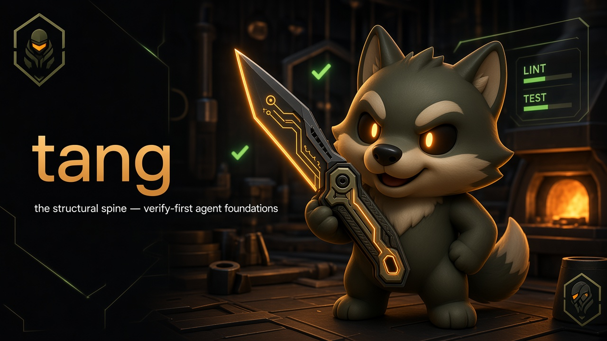

# Tang



**Tang — the structural spine of the knife.**

Agentic foundations for [DataKnifeAI](https://github.com/DataKnifeAI): deterministic verify packs, Cursor skills/playbooks, and a bootstrap CLI so new and existing repos hook into the fleet without shipping slop.

Mascot: a little workshop wolf ([square](docs/assets/tang-wolf-mascot.jpg)) — foundations first, then the fleet.

Runtime-agnostic (Cursor / Hermes / custom). Inspired by verify-first software factories ([talk](https://www.youtube.com/watch?v=O_zcc6Xl12g), [pstack](https://github.com/cursor/plugins/tree/main/pstack)): encode corrections as checks, spend tokens on verification, then scale dispatch.

| Sibling | Role vs Tang |
|---------|----------------|
| **Tang** | Foundations: lint/verify contracts, agent skills/playbooks, bootstrap into the fleet |
| [slashbay](https://github.com/DataKnifeAI/slashbay) | Intake + job queue (expects repos with a verify story) |
| [helmrail](https://github.com/DataKnifeAI/helmrail) | Fleet deploy + direct (command) |
| [fleetshade](https://github.com/DataKnifeAI/fleetshade) | Observe-only status board |
| [agent-skills](https://github.com/DataKnifeAI/agent-skills) / [agent-hub](https://github.com/DataKnifeAI/agent-hub) | Shared CLI skills + install catalog |

```
tang init / adopt
        │
        ▼
  .tang/manifest.yml + make verify + skills
        │
        ▼
  slashbay allowlist → warm dkai-agent → make verify before done
```

## What “hooked into Tang” means

- `make verify` — single gate agents must pass
- `.tang/manifest.yml` — packs, feature-map path, slashbay readiness
- Project skills under `.cursor/skills/` (Tang factory skills)
- `.cursor/rules/tang.mdc` — verify-first, lint over prose

## Quick start

```bash
# From a clone of this repo
./bin/tang status
./bin/tang adopt .                 # wire this repo (or pass a path)
./bin/tang init my-app --lang rust # scaffold ~/Projects/my-app (default)
./bin/tang verify                  # run make verify in the target
```

Install factory skills into a project:

```bash
./bin/tang adopt /path/to/repo
# copies plugin/skills → .cursor/skills/ and writes the rule + manifest
```

## Skills

| Skill | Job |
|-------|-----|
| `tang-mode` | Investigate → change → **verify** → open MR/PR |
| `tang-harden` | Turn a recurring agent mistake into a lint/CI check |
| `tang-feature-map` | Maintain a machine-readable feature map |
| `tang-babysit` | Drive MR/PR to green (`gh` / `glab`) |
| `tang-new-project` | `tang init` + slashbay + catalog listing |

## Language packs

Thin copy-in templates under `packs/`:

| Pack | Verify gate |
|------|-------------|
| `python` | ruff + pytest |
| `rust` | cargo fmt, clippy, test |
| `go` | gofmt / golangci-lint + test |
| `node` | biome/eslint + test script |
| `shell` | shellcheck + test placeholder |

When an agent needs correction, **add a check to the pack** — not a comment.

## Docs

- [Adopt an existing repo](docs/ADOPT.md)
- [Hook into Slashbay](docs/SLASHBAY.md)
- [Catalog touchpoints](docs/CATALOG.md)
- [Architecture](docs/ARCHITECTURE.md)

## Develop

```bash
make help
make verify   # shellcheck + skill layout checks
make test
```

## License

Apache License 2.0 · DataKnifeAI
